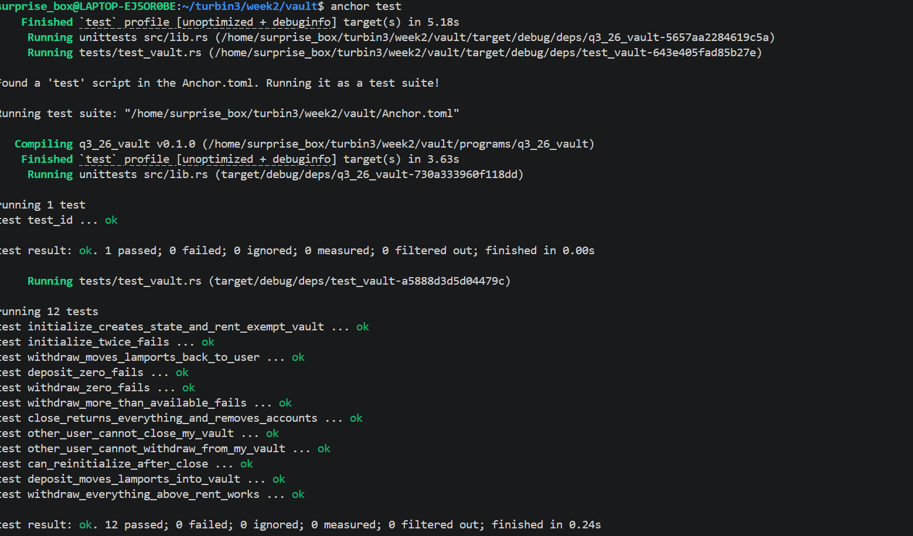

# Anchor Vault

A simple SOL vault on Solana, built with **Anchor** and tested with **LiteSVM**.
Each user gets their own vault. Only they can deposit, withdraw, or close it.

## Tests passing



## How it works

Each user has two accounts, both PDAs made from their wallet address:

- `vault_state` (seeds `["state", user]`): stores the bumps
- `vault` (seeds `["vault", user]`): holds the SOL

## Instructions

| Instruction | What it does |
|---|---|
| `initialize` | Creates the vault for the user |
| `deposit(amount)` | Moves SOL from the user into the vault |
| `withdraw(amount)` | Moves SOL from the vault back to the user (the vault must keep its rent) |
| `close` | Returns all SOL to the user and closes the accounts |

## Tests

12 tests in `programs/q3_26_vault/tests/test_vault.rs` cover:

- initialize, deposit, withdraw and close all work with the correct balances
- depositing or withdrawing `0` fails
- withdrawing more than the vault holds fails
- another user can't withdraw from or close your vault
- the vault can be opened again after closing

## Run

```bash
anchor build
anchor test
```

## What I learned

- A PDA holding SOL is a system account, so the program must **sign with the PDA's seeds** to move SOL out.
- Accounts must keep a minimum **rent** balance while they're open.
- Using the user's key in the seeds means **nobody else can touch your vault**.
